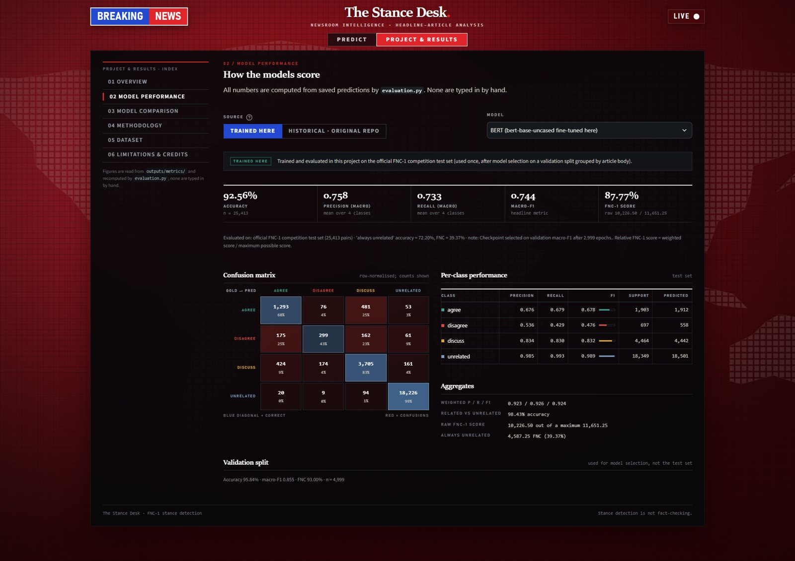
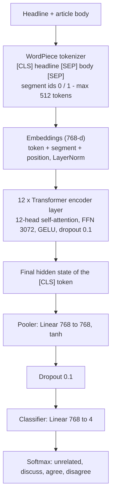
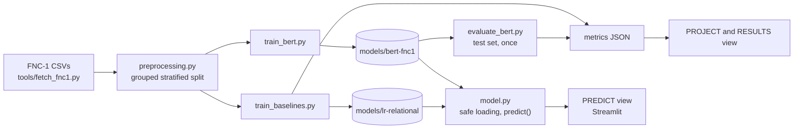

<div align="center">

# The Stance Desk

**Headline-to-article stance detection on FNC-1: a fine-tuned BERT, honest baselines, and a newsroom-style web app.**

[](LICENSE)


</div>

> **Stance detection is not fact-checking.** The model says how an article body relates to a headline (*agree*, *disagree*, *discuss*, *unrelated*). It does not say whether a claim is true.

Paste a story. The first line is the headline, everything below is the article. A BERT model trained in this project returns a stance and a probability for each of the four classes, in well under a second on a GPU.

## Highlights

- **Fine-tuned BERT** (`bert-base-uncased`, 109 M parameters) reaching **92.56 % accuracy, macro-F1 0.744 and an 87.77 % relative FNC-1 score** on the official 25,413-pair test set, scored once after model selection on a separate validation split.
- **Leakage-controlled evaluation.** The train/validation split is grouped by article body, stratified, seeded and stored in the repo, so no article appears on both sides.
- **Honest metrics.** 72.2 % of test pairs are *unrelated*, so "always unrelated" already scores 72.2 % accuracy. The project reports macro-F1, per-class F1 and the official FNC-1 score next to accuracy.
- **Audited starting point.** It re-implements a 2021 course project after a reproducibility and security audit, fixes the defects found, and keeps the original's results separate, labelled *historical, not reproduced* ([audit summary](docs/AUDIT_SUMMARY.md)).
- **Safe by design.** `safetensors`-only model loading, hash-checked fallback model, pinned modern dependencies, escaped HTML, offline inference.
- **Tested.** A pytest suite covers metrics (including a regression test against independently verified figures), data handling, model loading and failure modes, and the Streamlit UI.

## Contents

[Demo](#demo) · [Results](#results) · [Model architecture](#model-architecture) · [Quick start](#quick-start) · [Reproduce the results](#reproduce-the-results) · [Repository layout](#repository-layout) · [Testing](#testing) · [Limitations](#limitations-and-responsible-use) · [Documentation](#documentation) · [Contributing](#contributing) · [License and credits](#license-and-credits)

## Demo

| Predict | Results |
|---|---|
|  |  |

The app has two views. **PREDICT** takes one story, shows the verdict as a stamp on the story itself, and lists all four class scores, the engine, device and inference time, plus caveats (low confidence, truncated input). **PROJECT & RESULTS** shows model performance, a comparison against the baselines and the original project, methodology, dataset statistics and limitations. Every number there is read from `outputs/metrics/*.json`, never typed by hand. Two engines are available: **BERT** (default) and a CPU **Logistic Regression** fallback.

## Results

Official FNC-1 competition test set, 25,413 pairs. "Ours" rows were trained and evaluated in this project; "Historical" rows are the original project's self-reported predictions, recomputed here from its committed files, and **not reproduced** (its checkpoint was never published).

| Source | Model | Accuracy | Macro-F1 | Macro P / R | `disagree` F1 | FNC-1 relative (raw) |
|---|---|---|---|---|---|---|
| **Ours** | **BERT**, fine-tuned here | **0.9256** | **0.744** | 0.758 / 0.733 | 0.476 | **87.77 %** (10,226.50) |
| **Ours** | Logistic Regression, TF-IDF + relation features | 0.8823 | 0.573 | 0.629 / 0.575 | 0.045 | 80.62 % (9,393.00) |
| **Ours** | Logistic Regression + Count (original style, bug-fixed) | 0.5094 | 0.273 | 0.271 / 0.294 | 0.000 | 43.50 % (5,068.50) |
| **Ours** | Logistic Regression + TF-IDF (original style, bug-fixed) | 0.7040 | 0.248 | 0.264 / 0.265 | 0.000 | 41.80 % (4,869.75) |
| **Ours** | Bernoulli Naive Bayes (original style, bug-fixed) | 0.6460 | 0.256 | 0.273 / 0.268 | 0.000 | 42.35 % (4,934.75) |
| Historical | BERT (original authors' checkpoint) | 0.9038 | 0.691 | 0.691 / 0.694 | 0.363 | 86.41 % (10,068.25) |
| Historical | Logistic Regression + TF-IDF | 0.7063 | 0.243 | 0.263 / 0.262 | 0.000 | 41.33 % (4,815.50) |
| Historical | Logistic Regression + Count | 0.5767 | 0.275 | 0.277 / 0.283 | 0.000 | 43.14 % (5,026.75) |
| Historical | Bernoulli Naive Bayes | 0.6654 | 0.249 | 0.242 / 0.262 | 0.000 | 41.50 % (4,834.75) |
| Reference | Always predict *unrelated* | 0.7220 | n/a | n/a | 0.000 | 39.37 % (4,587.25) |

The relative FNC-1 score is the score divided by the maximum possible (11,651.25 on this test set). Validation (4,999 pairs, used for model selection): BERT accuracy 0.9584, macro-F1 0.855, relative FNC 93.00 %.

**BERT per class, test set**

| Class | Precision | Recall | F1 | Support |
|---|---|---|---|---|
| agree | 0.676 | 0.679 | 0.678 | 1,903 |
| disagree | 0.536 | 0.429 | 0.476 | 697 |
| discuss | 0.834 | 0.830 | 0.832 | 4,464 |
| unrelated | 0.985 | 0.993 | 0.989 | 18,349 |

### How to read these numbers

- **The original-style baselines are weak by construction**: a bag of words over `headline [SEP] body` cannot see how the two texts relate, so even with their bugs fixed their FNC-1 score sits only a few points above "always unrelated". The relation-feature Logistic Regression shows how far hand-built headline-body features go (80.6 %); BERT's joint self-attention over the headline-body pair adds about 7 points on top.
- **Ours vs historical is not apples to apples.** Input encoding (sentence pair vs one concatenated string), training subset (a body-grouped 90 % of the training file vs an unseeded, ungrouped 80 % for the original BERT and 70 % for its baselines) and the checkpoint-selection rule all differ. Read the historical rows as context, not as a head-to-head result.
- **Validation (macro-F1 0.855) is higher than test (0.744)** because the official test set contains topics absent from training. The test figure is the one to trust.
- **One training run, one seed.** Run-to-run variance was not measured; do not over-read differences of a few tenths of a point.

## Model architecture

The default engine is `BertForSequenceClassification` on `bert-base-uncased`: the headline and the article body are encoded as one sentence pair, passed through 12 Transformer encoder layers, and the pooled `[CLS]` representation is mapped to four class scores.



| Component | Detail |
|---|---|
| Parameters | 109,485,316 (3,076 in the new classifier head) |
| Input | `[CLS] headline [SEP] body [SEP]` with segment ids; `longest_first` truncation to 512 tokens (36 % of training pairs are truncated; the app warns when it happens) |
| Loss / optimiser | Cross-entropy; AdamW, lr 5e-5, weight decay 0.01 |
| Schedule | 500 warm-up steps, then linear decay; 3 epochs, effective batch 16 (8 x 2 accumulation) |
| Precision / hardware | fp16 mixed precision; 1 h 48 min on a single RTX 3050 Laptop GPU (6 GB, 3.8 GB peak) |
| Model selection | Best validation macro-F1, evaluated twice per epoch |
| Data | 44,973 training and 4,999 validation pairs, split grouped by article body |

The hyper-parameters are those of the original project; the deliberate deviations (sentence-pair encoding, macro-F1 selection, grouped split, fp16) are listed in [docs/DECISIONS.md](docs/DECISIONS.md).

### System architecture



The Logistic Regression fallback engine (headline and body TF-IDF, cosine similarity and overlap/refuting-word features), the original-style baselines, the evaluation protocol and the application modules are described in [docs/ARCHITECTURE.md](docs/ARCHITECTURE.md). A [model card](docs/MODEL_CARD.md) summarises intended use, results and caveats.

## Quick start

**Requirements:** Python 3.13 (the version everything here was tested with, on Windows 11; transformers 5 itself needs 3.11 or newer). An NVIDIA GPU is optional: the screenshots show a 26 ms prediction on an RTX 3050, and the CPU engines run too, only slower; training BERT needs a GPU with about 6 GB of VRAM.

> The fine-tuned weights are **not in this repository** (about 440 MB; GitHub's file limit is 100 MB). To use the BERT engine you train it yourself (step 3). Without weights the app still starts and shows **"Prediction engine not ready"**, and the results pages work from the committed metrics.

**1. Clone and install**

```powershell
git clone https://github.com/Akhil-428/The-Stance-Desk.git
cd The-Stance-Desk
py -3.13 -m venv .venv
.\.venv\Scripts\Activate.ps1
```

Install PyTorch for your hardware, then the remaining dependencies:

```powershell
# CPU only
python -m pip install torch --index-url https://download.pytorch.org/whl/cpu
# or NVIDIA GPU (CUDA 12.6 build, the one the results were produced with)
python -m pip install torch==2.14.1+cu126 --index-url https://download.pytorch.org/whl/cu126

python -m pip install -r requirements.txt
```

The exact environment that was tested is frozen in [requirements-lock.txt](requirements-lock.txt). On Linux or macOS use `python3 -m venv .venv` and `source .venv/bin/activate`.

**2. Get the data and the pretrained weights**

```powershell
python tools/fetch_fnc1.py          # downloads the 4 FNC-1 CSVs from a pinned commit, verifies SHA-256
```

Download `google-bert/bert-base-uncased` (revision `86b5e093…`) into `models/pretrained/bert-base-uncased/`; the file list and checksums are in [models/README.md](models/README.md).

**3. Train the models**

```powershell
python train_baselines.py                  # LR + Naive Bayes, CPU, about 8 minutes; creates the CPU engine
python train_bert.py --epochs 3 --evals-per-epoch 2    # BERT, about 1 h 48 min on an RTX 3050
python evaluate_bert.py                    # scores the test set once, writes outputs/metrics/ours/bert_fnc1.json
```

`python train_bert.py --smoke` runs a one-minute end-to-end check first.

**4. Run the app**

```powershell
streamlit run app.py          # http://localhost:8501
```

On Windows you can also double-click `run_app.bat`. Set `$env:FNC_DEVICE = "cpu"` to force the CPU. The app runs offline and binds to `localhost`.

## Reproduce the results

| Goal | Command |
|---|---|
| Recompute the original project's results from its committed predictions | `$env:FNC_ORIGINAL_REPO = "path\to\Fake-News-Stance-Detection"` then `python evaluate_historical.py` |
| Re-train all baselines | `python train_baselines.py` |
| Re-train and re-score BERT | `python train_bert.py --epochs 3 --evals-per-epoch 2` then `python evaluate_bert.py` |
| Verify the dataset | `python tools/fetch_fnc1.py --verify` |

A re-trained BERT will land close to, but not exactly on, the reported numbers: GPU kernels, library versions and fp16 make training non-bit-reproducible even with a fixed seed. The training log of the reported run is in [docs/training_log.jsonl](docs/training_log.jsonl).

## Repository layout

```
app.py                    Streamlit entry point
ui/                       Interface: navigation, PREDICT view, RESULTS view, theme, CSS
model.py                  Safe model loading and inference (BERT, Logistic Regression)
preprocessing.py          FNC-1 loading, input validation, grouped split, BERT encoding
features.py               Headline-body relation features for the Logistic Regression engine
evaluation.py             Metrics and the official FNC-1 score
train_bert.py             BERT fine-tuning (fp16, accumulation, macro-F1 selection, safetensors)
train_baselines.py        Logistic Regression and Naive Bayes (original-style and relational)
evaluate_bert.py          One-time test-set scoring of the fine-tuned BERT
evaluate_historical.py    Recomputes the original project's reported results
config.py                 Paths, labels, seed, hyper-parameters
tools/                    fetch_fnc1.py (verified data download), make_world_map.py
tests/                    pytest suite
data/                     splits/ (tracked), README with provenance; CSVs are fetched, not stored
models/                   README with provenance and checksums; weights are not stored in git
outputs/metrics/          ours/ and historical/ metrics JSON (the source of every reported number)
docs/                     ARCHITECTURE, DECISIONS, MODEL_CARD, AUDIT_SUMMARY, CHANGELOG, training log
.github/                  CI workflow, issue and pull request templates, Dependabot
```

## Testing

```powershell
ruff check .
python -m pytest -m "not gpu and not slow"      # about 20 seconds, no data or weights required
python -m pytest                                # everything, once data and models are in place
```

Tests that need the FNC-1 CSVs or model weights skip themselves with a clear reason when those files are absent (`pytest -rs`), so a fresh clone and CI run cleanly. The suite covers: metric correctness and the regression test against the original `BERT.csv` (10,068.25 / 11,651.25, accuracy 22,967 / 25,413); input validation; leakage-free splitting; model loading failures (missing folder, pickle checkpoint, wrong labels, tampered file); probability normalisation for each class; and the Streamlit UI end to end with `AppTest`.

## Limitations and responsible use

- **Not a fact-checker.** Stance is not truth.
- **`disagree` is hard.** It is the rarest class (2.7 % of test pairs); recall is 0.43 for BERT and near zero for the baselines.
- **Truncation.** BERT reads at most 512 tokens; evidence later in a long article is invisible to it.
- **Over-confidence.** Probabilities are not calibrated; BERT often reports above 99 % even when wrong.
- **Domain.** FNC-1 is English news from a 2017 challenge. Behaviour on other domains and languages is unknown.
- **Single run.** No variance estimate across seeds; no class weighting; the linear models had no hyper-parameter search.
- **Not a reproduction of the original 90.37 %.** It is a new run under a stricter protocol; see [the audit summary](docs/AUDIT_SUMMARY.md).
- **The fallback model uses `joblib` (pickle).** It is loaded only after a SHA-256 check against `model_info.json`. Never put a model file from an untrusted source in `models/`.

**Academic integrity.** This is an independent re-implementation and study of a 2021 course project. If you are a student, do not submit it or code from it as your own coursework.

## Documentation

| Document | Contents |
|---|---|
| [docs/ARCHITECTURE.md](docs/ARCHITECTURE.md) | Models, training pipeline, evaluation protocol, application modules, diagrams |
| [docs/MODEL_CARD.md](docs/MODEL_CARD.md) | Intended use, data, metrics, caveats, ethics |
| [docs/DECISIONS.md](docs/DECISIONS.md) | Every deviation from the original project, and why |
| [docs/AUDIT_SUMMARY.md](docs/AUDIT_SUMMARY.md) | Findings about the original project and the fix list (K1 to K18) |
| [docs/CHANGELOG.md](docs/CHANGELOG.md) | Release notes |
| [data/README.md](data/README.md), [models/README.md](models/README.md) | Provenance, checksums, how to obtain data and weights |
| [SECURITY.md](SECURITY.md), [CONTRIBUTING.md](CONTRIBUTING.md), [CODE_OF_CONDUCT.md](CODE_OF_CONDUCT.md) | Policies |

## Contributing

Issues and pull requests are welcome. Please read [CONTRIBUTING.md](CONTRIBUTING.md) first; it covers setup, checks, and what must never be committed (datasets, weights, personal paths).

## License and credits

Code is released under the [Apache License 2.0](LICENSE). See [NOTICE](NOTICE) for third-party credits.

This project builds on:

- **Fake-News-Stance-Detection** by Zeyong Jin, Yuqing Wu and Zhi Feng (SFU CMPT 413/713, Group AWSL, 2021), [github.com/zeyongj/Fake-News-Stance-Detection](https://github.com/zeyongj/Fake-News-Stance-Detection) (Apache-2.0): the task framing, label mapping, hyper-parameters and baseline design. No source code was copied.
- **The Fake News Challenge (FNC-1)**, [github.com/FakeNewsChallenge/fnc-1](https://github.com/FakeNewsChallenge/fnc-1): dataset and scoring rule. The data is fetched, not redistributed; see that repository for its terms.
- **BERT**: Devlin, Chang, Lee and Toutanova, *BERT: Pre-training of Deep Bidirectional Transformers for Language Understanding*, 2018, [arXiv:1810.04805](https://arxiv.org/abs/1810.04805). Weights: [`google-bert/bert-base-uncased`](https://huggingface.co/google-bert/bert-base-uncased) (Apache-2.0).

If you use this project, please cite it with [CITATION.cff](CITATION.cff) (GitHub's "Cite this repository" button).
