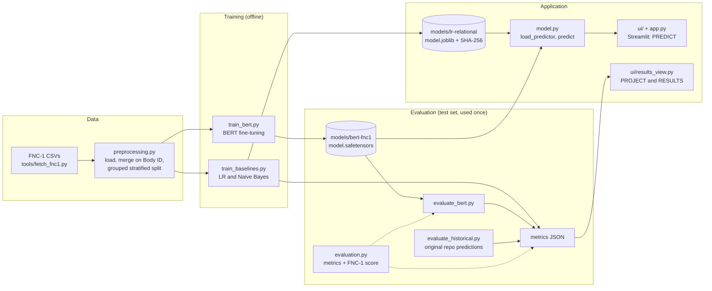
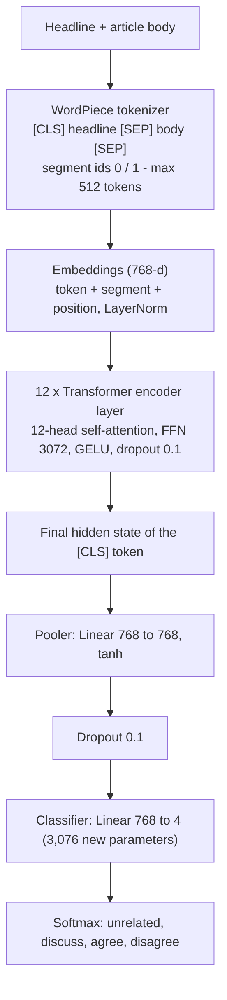
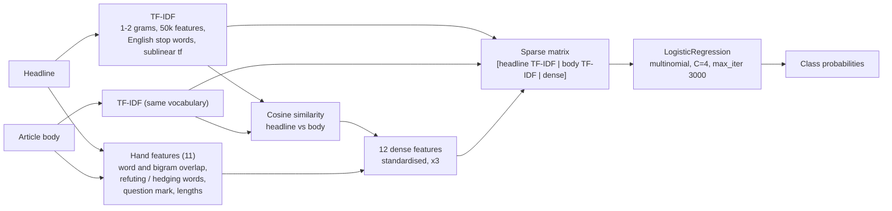
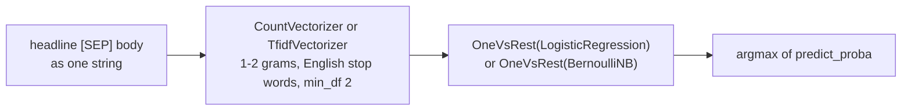

# Architecture

This document explains how the system is put together: the models, the training pipeline, the evaluation protocol and the application. Every number below is read from the code (`config.py`, `train_bert.py`, `features.py`, …) or from `models/*/model_info.json`; none is typed from memory.

## 1. The task

Input: a **headline** and an **article body**. Output: one of four stances describing how the body relates to the headline, plus a probability for every class.

| Label | id | Meaning |
|---|---|---|
| `unrelated` | 0 | The body is about a different topic. |
| `discuss` | 1 | The body discusses the claim without taking a position. |
| `agree` | 2 | The body supports the claim. |
| `disagree` | 3 | The body refutes or contradicts the claim. |

The ids follow the original notebook so that numbers line up. Stance detection is **not** fact-checking: an article can *agree* with a false claim.

## 2. System overview

Design rules that hold everywhere:

- **No hard-coded predictions or metrics.** The app shows a prediction only from a loaded model, and every figure on the results pages is read from `outputs/metrics/*.json`. With no model it says "Prediction engine not ready".
- **One input builder.** Training, evaluation and the app all go through `preprocessing.bert_encode` and `preprocessing.validate_inputs`, so they cannot drift apart.
- **The test set is touched once**, after model selection on the validation split.

## 3. BERT engine (default)

`BertForSequenceClassification` on `bert-base-uncased`: **109,485,316 parameters**, 12 layers, hidden size 768, 12 attention heads, feed-forward size 3072, GELU, vocabulary 30,522, 512 positions.

**Input encoding (decision D1).** The pair is encoded as `[CLS] headline [SEP] body [SEP]` with `token_type_ids` (0 for the headline, 1 for the body). Truncation is `longest_first` to 512 tokens, so the short headline is never cut. In the training split the mean pair length is 379 tokens and **36.4 % of pairs exceed 512 tokens** and lose the tail of the body (the app warns when this happens). The original project joined the two texts into one string with a literal `"[SEP]"` and no segment ids; the tokens are the same, only the segment signal differs.

**Training recipe** (`train_bert.py`, values from `config.py`; the original's recipe unless marked):

| Setting | Value |
|---|---|
| Loss | Cross-entropy (no class weights) |
| Optimiser | AdamW, learning rate 5e-5, weight decay 0.01 (not applied to bias and LayerNorm) |
| Schedule | Linear warm-up for 500 steps, then linear decay to 0 |
| Batch | Effective 16 (micro-batch 8 x 2 gradient-accumulation steps) |
| Epochs | 3 (8,433 optimiser steps planned, 2,811 per epoch) |
| Precision | fp16 autocast with gradient scaling (changed: fits 6 GB VRAM) |
| Gradient clipping | 1.0 |
| Seed | 42 |
| Selection | Best validation **macro-F1**, evaluated twice per epoch; only improving checkpoints are saved (changed from validation loss) |
| Data | 44,973 training pairs, 4,999 validation pairs, split grouped by Body ID |
| Padding | Dynamic per batch (collate function), not padded to 512 |

The reported run (`docs/training_log.jsonl`): 107.6 minutes on one RTX 3050 Laptop GPU (6 GB), about 0.75 s per optimiser step, 3.78 GB peak VRAM. The best checkpoint was saved at step 8,430 (validation accuracy 0.9584, macro-F1 0.855, relative FNC 93.0 %). Weights are saved as `safetensors` only.

## 4. Logistic Regression engine (CPU fallback)

A multinomial Logistic Regression (`C=4.0`) on a sparse feature matrix built by `features.RelationalFeatures`. It exists because a bag of words over the concatenated text cannot represent the *relationship* between headline and body (audit K6).

The feature design is inspired by the organisers' baseline for FNC-1. It is clearly a different design from the original project's baselines, and is labelled as such everywhere.

## 5. Original-style baselines (comparison only)

Bug-fixed re-implementations of the original project's baselines, trained on the same split:

Differences from the original: correct encoder names, `argmax(predict_proba)` instead of argmax over 0/1 outputs, vectorisers fitted inside a `Pipeline` on the training fold only, Naive Bayes reported once, `min_df=2` added to bound memory. They reach only 41.8 to 43.5 % relative FNC score because a bag of words over the concatenation carries almost no headline-body relation, which is the point of the comparison.

## 6. Evaluation protocol

- **Split.** `StratifiedGroupKFold(n_splits=10, shuffle=True, random_state=42)`, fold 0, groups = `Body ID`. No article body is on both sides. Indices are stored in `data/splits/train_val_split.json`.
- **Model selection** uses validation data only. The official FNC-1 competition set (25,413 pairs) is scored once at the end.
- **Metrics** (`evaluation.py`): accuracy, macro and weighted precision/recall/F1, per-class metrics with support, a 4x4 confusion matrix, related-vs-unrelated accuracy, the "always unrelated" reference, and the **FNC-1 score**.
- **FNC-1 score.** For each pair: +0.25 if gold and prediction agree on related vs unrelated; +0.75 more if gold is related and the exact stance is right. `MAX` is the score of a perfect submission, `NULL` the score of "always unrelated", and the *relative score* is `score / MAX`. Rows are matched in order and validated: a length mismatch or unknown label raises an error rather than being silently truncated.
- **Regression test.** `tests/test_evaluation.py` requires that scoring the original project's committed `BERT.csv` gives exactly 10,068.25 / 11,651.25, accuracy 22,967 / 25,413 and macro-F1 0.691, matching an independent implementation.

## 7. Application

| Module | Responsibility |
|---|---|
| `app.py` | Streamlit entry point; calls `ui.navigation.run_app()` |
| `ui/navigation.py` | Masthead and the two views (PREDICT, PROJECT & RESULTS); session state |
| `ui/predict_view.py` | Story box, analysis state, verdict stamp and report |
| `ui/story.py` | Splits the single text box into `(headline, body)`: first line is the headline |
| `ui/results_view.py` | Overview, performance, comparison, methodology, dataset and limitations sections |
| `ui/common.py` | Cached loaders for metrics JSON, model info, engines, dataset statistics |
| `ui/theme.py`, `ui/static/` | HTML builders (all user text escaped), stylesheet, map SVG |
| `model.py` | `load_predictor()`, `BertStancePredictor`, `LRStancePredictor`, device handling, error types |

Inference path: *story box* -> `ui.story.split_story` -> `preprocessing.validate_inputs` -> `bert_encode` -> model forward pass (CUDA if available, otherwise CPU; a CUDA out-of-memory error falls back to CPU for that request) -> softmax -> label and four probabilities.

Failure modes are explicit and tested: empty or symbol-only input, over-long input, missing model folder, a pickle checkpoint, a configuration with the wrong labels, a tampered LR file (hash mismatch), and inference exceptions.
